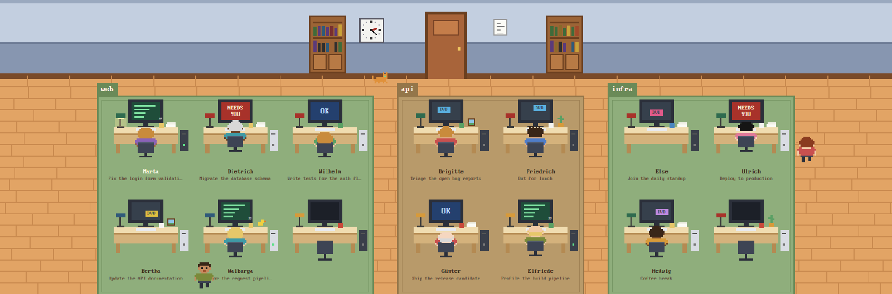

# herdr-office-layout

The **Office** layout for the Herdr app: a pixel-art office where every coding agent is a little
office worker at a desk. Typing, stuck waiting on you, dozing after a finished job, or off at the
water cooler: you can tell at a glance. See [office/RECIPE.md](office/RECIPE.md) for how it is
built.



## Installation

Ask your agent to add this layout (it reads every file first), or by hand:

1. Copy `office/layouts/*` into `~/.config/herdr-app/layouts/`.
2. Copy `office/mods/office` into `~/.config/herdr-app/mods/`.
3. Pick **office** in the Herdr settings, or run:
   ```sh
   herdr-app do layout.switch --name office
   ```

`ctrl-shift-l` cycles back to your previous layout. Delete the copies to remove it.

Nothing to install: the pixel font ships with the mod. It makes no network requests, runs no
programs of its own and reads no files outside its folder. Clicking **Neuen einstellen** in the
wood strip asks for a project folder, then opens a new tab running `omp` there, as set by the
rail's `agent` prop in the layout (Herdr's `tab.new`). Canceling the folder picker opens nothing.
A space on another machine skips the local picker and starts in that space's own folder.

## The office

| Worker | Screen | Agent status |
| --- | --- | --- |
| Bobbing at the keyboard, coffee steaming | green, code scrolling | working |
| Jumping | red, blinking **NEEDS YOU** | blocked: waiting for you |
| Head down, `zZz` | blue `OK` | done while you weren't looking |
| Sitting still, or out wandering | bouncing DVD screensaver | idle |

- Idle workers (and now and then finished ones) get up and wander: to the water cooler (back with
  a cup), a bookshelf (with a book), the window, the door, the plant, or another worker's desk for
  a chat. They keep to the walkways and hurry back when their agent starts working.
- New agents walk in through the door to their desk.
- Every worker looks different (hair, skin, hairstyle, glasses), and their shirt colour follows the
  kind of agent. Each gets an old-fashioned German name and a line under the desk with what they
  are working on, taken from the terminal title OMP reports. Desks get random clutter, and an
  office cat roams the floor.
- The clock shows the real time, the window goes from day to sunset to night, and the room dims
  at night while desk lamps come on.
- A wall-mounted **OMP stats** screen shows live OMP sessions and their completed turns, counts
  for working / needs you / done / idle, and a four-minute activity strip.
- Click a worker to jump to that agent. Hover a desk for a sticky note with its name, tab,
  project, space, title and status.
- Each project gets its own group of desks on a coloured rug, with its name on a tag: a space
  someone named, or else the folder the agent's terminal works in.
- One row of four desks shows by default; more desks (and rows when they fit better) appear as
  agents join, and everything shrinks to fit. Workers scale with them and stay crisp.
- Click **Neuen einstellen** in the strip below the office, pick the project folder, and `omp`
  starts there.
- Workers keep to their own line in the walkways and wait for each other (and the cat).

Under the office a wood strip shows the current space and tab plus the **Neuen einstellen**
button, and your terminals get the rest of the window in wood frames.

## Credits

- Font: [PxPlus IBM VGA 8x16](https://int10h.org/oldschool-pc-fonts/) by VileR, CC BY-SA 4.0
  (licence in `office/mods/office/fonts/`).

## License

Code: [MIT](LICENSE). The bundled font keeps its own CC BY-SA 4.0 licence.
