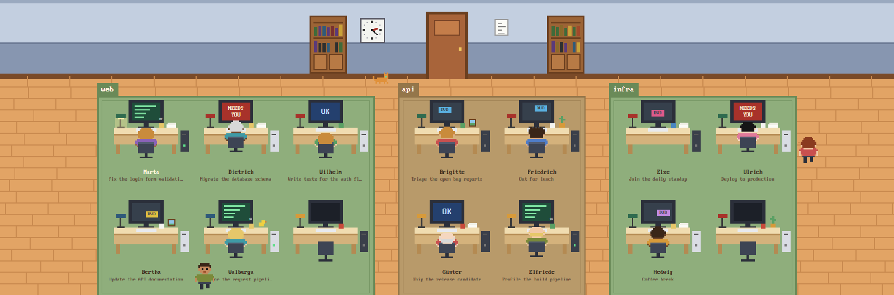

# Office

A pixel-art office for the Herdr app. Every agent is a little office worker at a desk: you can see
who's typing, who's stuck waiting for you, who finished and dozed off, and who wandered off to the
water cooler. The first worker is always Michels Mum, and she takes her breaks in the smoking
corner instead. The office fills the top of the window, a wood strip runs under it, and your
terminals sit below in wood frames.

## What you see

One fixed look: no system title bar, root background `#8a5530`, theme `graphite` with
`background #1e2230`, `accent #e2a465`, `border #8a5530`. Pixel text is `PxPlus IBM VGA 8x16`
(shipped in `mods/office/fonts/`). Nothing is rounded. Top to bottom:

1. **Office**, fixed 400px tall. Dragging it moves the window.
   - **Wall**, 150px: upper wall `#c3cfe0` (6px `#9aa9bf` band at the top), wainscot `#8796b0`
     from 80px with a 4px `#6e7c96` rail, 10px `#7a4a28` skirting.
   - **On the wall**, placed from the midline `mid` and the right edge `w`: bookshelves at
     `mid-260` and `mid+190` (70×110 `#9c6436`, two rows of random books, two cupboard doors), a
     clock at `mid-165` (48px, hour marks, real time: long black minute hand, short red hour hand), a door at `mid-40`
     (80px, `#a8643a`, opens to a dark doorway while someone arrives), a notice at `mid+90`, a
     window at `w-340` (day `#8fd0f5` with clouds, 17–19h sunset `#f2a65a`, 19–6h night
     `#1d2547` with moon and stars; seasonal details behind the mullions, see **Seasons**), a
     framed picture at `w-200`, a water cooler at `w-112`, a **Raucherecke** at the left end of the
     wall (`RAUCHEN` sign, a small ashtray stand and cigarette butts on the floor), and an
     **office stats** screen in the gap between the right bookshelf and the window (or left of the
     shelves when that gap is too narrow): a 236×116 dark screen in a brown frame at y=18,
     `OFFICE` + `STATS`, a live dot, all sessions on the floor, completed turns,
     working / needs you / done / idle counts and a four-minute activity strip. When someone is
     blocked, its bottom label row becomes a blinking red `NEEDS YOU` with that worker's name and
     `+N` others; clicking it focuses the displayed agent and advances the queue. The screen is
     left out below about 1290px wide, and the queue goes with it.
   - **Floor** `#e2a465` with `#c98a4f` planks every 22px, seams staggered at random, a few knots.
     A potted plant in the bottom-right corner.
   - **Sign**, top-left: white card, 3px `#6b3f1f` border, `THE OFFICE` (16px) over
     `N on the clock` (12px). When there is floor news, a third line (10px, 92 wide, wrapped)
     shows the newest event and nothing older.
   - **Desks**: slots of 170×190 at scale k, one per agent (or Shell-o-mat, below): one row up
     to four slots (more rows only when they fit better), one group of columns per project (a
     space someone named, else the live folder of the pane), groups 60k apart, centred, starting
     `40k` below the wall. Each group sits on a solid rug (a colour per project, never the same as
     its neighbour, with an inner border) sized to its own slots, with the project name on a tag
     at its top-left corner. An empty office shows no desks. A slot holds a monitor
     (66×44 `#2b2f3a`, 54×34 screen), a desk
     (`#f0dcb0` top, `#d4b27c` front, legs), keyboard, mug, desk lamp, a PC tower (light or dark)
     and one random piece of clutter (papers, plant, cactus, photo, rubber duck, or nothing). The
     worker's program icon and old German given name (12px) sit 130 down, with the current task
     (the agent's terminal title, 10px, wrapped across the slot width) on the lines below. The rest
     of the slot, 130 to 190, is the aisle.
   - **Shell-o-mat**: a tab with terminal panes but no agent gets no desk but a command vending
     machine on its project's rug, also in a 170×190 slot: a 92×108 dark-green cabinet with a cream `SHELL`
     marquee, a green screen showing `>` and a blinking `_`, three small buttons and a big red
     button, a coin slot, a paper tape curling out, a mug and a stack of manuals beside it. The
     tab's program icon and `Tab <name>` (12px) sit 130 down, with `Shell-o-mat` (10px) below.
     A small LED on the marquee blinks when that tab is the shown one in its space. Clicking the
     machine runs `tab.select`. A project with only shell tabs gets its own rug and tag.
   - **Workers**: pixel sprites at `s` screen px per art pixel, `s` in half-pixel steps and
     `k = s / 3`, so desks and workers always scale together. Seated (16×20, from
     behind, in a `#3d4454` office chair) or standing (12×17, front or back view, legs swinging).
     Random per agent but stable: hair (8 colours), skin (6 tones), hairstyle (short, long, bun,
     bald, spiky), glasses (30%). The shirt colour follows the agent kind (`claude #d97757`,
     `codex #2f3640`, `gemini #4f7dc9`, `opencode #8a62b8`, `pi #e58fb6`, `grok #5b5b66`, ...),
     otherwise random. The first worker, Michels Mum, always looks like a woman: long hair or a
     bun, a coloured skirt while standing and lipstick in the front view.
   - **Cat**: a 10×7 sprite in a random coat, roaming the walkways or sitting on a blocked
     worker's desk in front of the monitor; click it to pet it, click again while the `♥` is
     up to tease it with a red laser dot.
2. **Strip**, 28px `#8a5530`: the active space's name in `#fff1d6`, a `/`, then one chip per tab
   of that space in host order (22px high, 6px padding, 5px gap): program icon (12px), tab name
   (max 110px, truncated) and a 6px status dot (green working, red blocked, blue done). The active
   chip is cream `#fbfbf6` with a `#6b3f1f` border and a small `x`; the rest sit on the wood with
   cream text. Long strips scroll sideways. Two cream buttons stay on the right: **Neuen
   einstellen**, and **Shell** beside it (a plain terminal in the active space's folder).
3. **Terminals**, weight 1, 12px side padding and no vertical padding, so the panes reach the bottom:
   the active tab, every pane (a lone one too) in a
   4px `#5c3418` frame (`#e2a465` when focused), 10px apart, with a 26px `#c99a62` header: program
   icon and name, status in capitals on the right (`NEEDS YOU` in `#a8322a` when blocked).

## How it behaves

- **working**: green screen `#1f4d3a`, four `#7ee0a0` code lines growing and shrinking; the worker
  bobs at the keyboard; tower LED green; coffee steam over the mug.
- **blocked**: red screen `#a8322a` blinking `NEEDS` / `YOU` (`!` when the screen is too small);
  the worker jumps.
- **done**: blue screen `#24406e` reading `OK`; head down, `zZz` cycling.
- **idle / unknown**: dim screen `#36404c` with a screensaver: a `DVD` logo (colour fixed per
  agent) bouncing off the edges, its own speed per agent.
- **Wandering**: each second an idle worker gets up with chance 3.5% (done 1.5%) and goes to the
  water cooler (comes back holding a cup), a bookshelf (a book), the window, the door, the plant,
  a random spot in an aisle, or another seated worker's desk (a chat bubble: `...` or a short
  line). They stay 3–11s and walk back. Starting work or getting blocked sends them straight
  back. Michels Mum's spot list swaps both water-cooler entries for `smoke`: she walks to the
  `RAUCHEN` sign, faces the wall, holds a cigarette and shows a `~` smoke wisp. Everyone else
  keeps the usual spots.
- **Small talk**: while a worker is `there` at the water cooler or at a `chat` desk, one speaker
  per spot shows a 100px white speech bubble with one of 12 short German office lines. The speaker
  is the visitor with the lowest `hash(address)`; the other chat visitor keeps the animated `...`
  bubble, and thoughts are suppressed at those spots. The line is picked from `hash()` of the
  address and the trip's `until`, so it stays the same for the whole stay.
- **Cat**: the cat walks the same walkways at 0.07 px/ms and rests 1–4s at most destinations
  (40% of the other rests last 8–23s). For each new destination, with 60% chance when someone is
  blocked, it goes to that worker's desk instead: it walks to the aisle and up to the seat, sits
  on the desk in front of the monitor (`onDesk`, no draw offset, facing left), stores the worker's
  address in `watch`, and stays 18–40s. When the watched worker recovers or leaves, the cat clears
  `watch`, ends the rest and walks off. This desk hop is the one deliberate exception to the
  walkways. Clicking the cat sets `pet` for 2.5s and shows a `♥` bubble. A second click within
  those 2.5s starts the laser: a red dot appears on a walkway away from the cat, the cat chases
  it at 1.6× its walking speed (0.112 px/ms) along the lane centre, and the dot hops to a fresh
  spot the cat can reach within 2.6s whenever it catches it. The chase lasts 6s; clicking the cat
  during it ends the game and pets it again.
- **Walkways**: the corridor along the wall (walker top at `WALL-40`), the aisle behind each row
  (`row top + 128k`), a lane past each end of the rows and one between each pair of space groups.
  Everyone keeps to their own line, up to ±8k off the middle, and waits (up to 1.5s, the cat 2s)
  before stepping where someone else is standing. Walkers do not block each other, and a waiting
  worker stands with still legs instead of walking on the spot. A walk is straight legs between them:
  out of the chair into the aisle, along to the nearer end lane, up or down it, along to the spot.
  Speed 0.11 px/ms (cat 0.07). Workers face the way they walk and face the wall at wall spots.
- **Arrivals**: a new agent's worker appears in the doorway, the door opens for 4s, and they walk
  to their desk.
- **Thoughts**: now and then a seated worker shows `?`, `!`, `♪`, `♥`, `...`, `☼`, `$` or `#`
  for a few seconds.
- **Names and tasks**: the first worker on the floor is always Michels Mum. Every other worker
  draws an old-fashioned German given name, unique among the agents on the floor and kept for the
  session; a former first worker gets a normal name back if it loses the first desk. Under every
  occupied desk, below the name, is what the agent is working on: `a.title`, the terminal title
  OMP already reports, minus its `π >` or spinner/icon prefix (or the tab name when the title is
  only a shell path or program name), wrapped to the slot width so the whole title stays readable.
- **Projects**: desks and shell stations are grouped by project: a space someone named, else the
  pane's live folder (`panes()[].cwd`), whose last path part names the rug. The live folder
  follows a shell or agent that changes directory (omp switches projects without changing its
  process cwd, which is all `terminals()[].cwd` reports). Agents and shell tabs in the same folder
  share a rug; an agent with no pane folder falls back to its terminal's, then to its space, and a
  shell tab falls back to its first pane's folder, then to its space. Windows paths compare
  case-insensitively.
- **Office stats**: the wall screen covers every agent on the floor, not just OMP: it counts
  every agent in `crew` (`list`), sums `turn` for every terminal matched by address, shows
  working / needs you / done / idle counts, and plots how many workers were busy over the last
  four minutes, sampled every ~10s into `hist` (24 bars); Shell-o-mats are not agents, so they
  add no sessions or blocked rows. When nobody is blocked the bottom row
  reads `ACTIVITY · 4 MIN`. It hangs between the right bookshelf and the window, or left of the
  shelves when that gap is narrower; it is drawn each render over the retained room, dims with the night
  overlay, and is left out below about 1290px wide.
- **Needs-you queue**: when at least one worker is blocked, the stats board's bottom row replaces
  `ACTIVITY · 4 MIN` with a blinking red `NEEDS YOU` and the German name of
  `blocked[blockedCursor % blocked.length]`, plus `+N` for the others. Clicking it stops
  propagation, focuses that terminal with `run("agent.focus", { terminal })`, and advances
  `blockedCursor`; in demo mode it is display-only. It covers every blocked agent, not only OMP.
- **Event ticker**: the sign's third line shows `news[0]`, the newest floor event. `pushNews()`
  unshifts `{text, tone}`, keeps six and ignores an immediate repeat. Events are arrivals
  (`Neu: <name>`, green), a status change to blocked (`<name> braucht dich`, red) or done
  (`<name> ist fertig`, green), and every new hundred of a terminal's `turn`
  (`<name>: N Turns`, brown). `since` detects status transitions, `lastTurn` detects turn
  milestones (first sight is silent; a lower turn resets the baseline), and `known` detects
  arrivals. `since` and `lastTurn` are pruned when an agent leaves. Demo starts with
  `Neuer Kollege: Dietrich`.
- **Seasons**: the window keeps day/sunset/night and clouds, and adds seasonal details in a
  clipped transparent pane at (2,2) 78×64, with the mullions drawn after. Dec–Feb: 6–10 white
  2×2 snowflakes; December adds 8 colored 4×4 bulbs on a wire above the frame. Mar–May: 5–7 pink
  petals, and April adds 4–6 rain streaks. Jun–Aug: an 8×8 sun with rays in the daytime sky only
  (dusk and night keep their sun/moon). Sep–Nov: 5–7 orange/brown leaves. Seasonal randomness uses
  its own seeded stream (`seed ^ ((month+1)*0x9e3779b9)`), leaving the room's sequence untouched.
  `loop` is a from→to→from pulse, so flakes, petals, rain and leaves drift down and back.
- **Night** (19–6h): the office dims under `#0b123650` and every desk lamp glows. At 17–19h a warm
  tint.
- **Tabs**: the strip shows every tab of the active space, not only the current one. Clicking a
  chip runs `tab.select`; the active chip's `x` runs `tab.close`; the wheel over the strip runs
  `tab.prev`/`tab.next`. Its icon is the tab's first agent pane (else its first pane), and its dot
  is `TabInfo.status`, the most urgent agent status in the tab. The floor is independent of the
  shown tab: every agent in every tab keeps its worker and desk.
- Clicking a worker or their desk runs `agent.focus`; the stats board's `NEEDS YOU` row focuses
  the displayed agent and advances `blockedCursor`; clicking the cat pets it, and a second click
  while the `♥` is up starts the laser chase. The
  **Neuen einstellen** button in the strip first asks for a project folder with
  `pickFolder({ prompt: "Starten" })` when the active space is local (canceling starts nothing),
  then opens a tab in that folder in the active space running the rail's `agent` prop (`"omp"` in
  `office.json`). A space on another machine skips
  the local picker and starts its tab in that space's own folder. A program Herdr's table does
  not list (omp) starts as its bare command, and without the prop the first installed agent
  from `knownAgents()` is used. The **Shell** button beside it runs
  `run("tab.new", { space, folder })` with the active space's folder and no `argv`, so Herdr
  starts its default shell there for the project's commands; there is no picker and no agent.
  An empty space folder leaves Herdr's default (the focused terminal's folder).
  Clicking a **Shell-o-mat** runs `tab.select` with its tab id, so the floor doubles as a tab
  picker per project; its tag reads `Tab <name>` over `Shell-o-mat`.
  Hovering a desk shows a yellow sticky note: name, tab, project, space, title, status. Desk
  order is the project-grouped order and is passed to `setAgentOrder`.
- **Fit**: tries 1–6 rows, each project getting `ceil(n / rows)` columns for its `n` slots (an
  agent desk or a Shell-o-mat), with
  `k = min(1, (w-200)/(cols·170 + gaps·60), (h-150)/(rows·190+40))`; more rows win only when
  they make k at least 0.08 bigger. Then `s = max(1, floor(6k)/2)` and `k = s/3`.

## Built from

- `layouts/office.json`: a `column` of three blocks: `office-floor` (mod `office`,
  `window_drag`), `office-rail` (mod `office`, props `{role: "rail", agent: "omp"}`) and
  `office-desks` (`{tab: "active"}` with a pane frame whose header is mod `office`, props
  `{role: "pane"}`).
  `preview` points at `layouts/office.svg` for the settings screen.
- `mods/office/art.js`: sprites as rows of palette letters (`sprite(rows, palette, s)` draws one
  `div` per run of a colour), the room (including `smokingArea()` and the seasonal window
  `window_(x, now, seed)`), desk clutter, and per-agent looks seeded from a hash of the agent's
  address. The window derives hour and month from `now`: day/dusk/night, then snow, petals/rain,
  a sun or leaves, plus December lights. `look(a, { woman: true })` swaps in long hair or a bun,
  a skirt and lipstick.
- `mods/office/main.js`: one mod, three roles by `props().role`. The room (wall, floor,
  furniture) is a retained nested view (`cx.new`), rebuilt only when the size, the minute or the
  door changes. A 50ms timer advances walks (one straight leg at a time), so legs start at their
  corner instead of waiting for a coarse tick; once a second it rolls for new walks, thoughts and
  the cat. It calls `cx.notify()` only when something changed. Every movement is a native
  `.transition("left"/"top")`. Bobbing, legs, blinking and `zZz` are native `loop`/`frames`. Desk
  groups come from `spaces()` (a named space) and the pane's live `cwd` in `panes()`. A tab with
  panes but no agent adds a Shell-o-mat to its project's group instead of a desk; its screen
  cursor uses `frames` and its marquee LED uses `loop`. The wall office screen is rebuilt by `render()` from
  `agents()` and `terminals()` for every agent on the floor; `tick()` samples the busy-worker count
  into `hist` every ~10s. `render()` also maintains
  the needs-you cursor (`blockedCursor`), the news feed (`pushNews` into `news`, fed by `since`
  and `lastTurn`), and the cat's `watch`; `moveCat()` steers it to blocked desks, and
  `startLaser()`/`laserHop()` send it after the dot. `tick()` expires the petting bubble (`pet`)
  and the 6s laser (`laser`). `SMALL_TALK` lines are chosen per stay in `worker()`.
  `render()` also sets `mumAddress` to the first agent:
  `nameFor()` gives that address `Michels Mum`, `look()` renders her as a woman, and `tick()` picks
  from `MUM_SPOTS` (the cooler entries replaced by `smoke`).
- `props: {demo: true}` on `office-floor` and on `office-rail` fills it with 12 sample workers in
  every state, in three spaces, who wander four times as often, shows three inert sample tabs
  (`web`/`api`/`infra`) instead of the host's tabs, and disables agent focus and the hire and
  shell buttons; it draws no Shell-o-mats, because those sample tabs are not real, and the stats
  queue is display-only, but the cat can still be petted and chased after the laser. It also seeds
  `Neuer Kollege: Dietrich`.
  The preview was taken that way.
- Uses `agents()`, `spaces()`, `panes()`, `terminals()`, `knownAgents()`, `pickFolder()`,
  `run("agent.focus")`, `run("tab.new")`, `run("tab.select")`, `run("tab.close")`,
  `run("tab.prev")`, `run("tab.next")` and `setAgentOrder`. No network, no `exec`, no files
  outside its folder.

## Watch out

- `herdr-app check` aborts (a native panic, not a script error) on any mod that uses
  `.transition(...)`, including a five-line test mod, so it can't vouch for this one. Check by
  switching to the layout and looking at `herdr-app status` and `herdr-app shot`.
- Hot reload doesn't always fire through a symlinked mod folder: `layout.switch` away and back.
- Loops and transitions need a stable `.id()`, or they restart every render.
- Walkers pass over the name labels in the aisles.
- The `smoke` spot in `spotPlace()` (wall x ≈ 52 plus jitter) and the Raucherecke in
  `smokingArea()` (sign, ashtray at x ≈ 120) are hand-matched: move them together. The first agent
  is `list[0]`, i.e. the first desk; if the host order changes, the name moves to the new first
  agent and the old one gets a normal German name back.
- A project is a named space, else the pane's live working folder: an agent started in `~` (for
  example bare `omp`) shares the home rug with every other home-folder agent. Start it in its
  project folder (or use **Neuen einstellen**) for a rug of its own.
- Desk titles wrap instead of truncating, so a title longer than the 60-unit aisle reaches into the
  next row (and walkers draw over it); it stays complete either way.
- The office stats screen needs the gap between the right bookshelf and the window, or the wall
  left of the shelves beside the sign. Below about 1290px wide it is left out rather than
  overlapping the wall furniture, and the `NEEDS YOU` queue disappears with it. The screen,
  counts, turn total and `hist` cover every agent on the floor: there is no OMP filter, so a busy
  non-OMP terminal still moves `TURNS` and the strip.
- The cat's trip to a blocked desk is the only deliberate exception to the walkways: it uses the
  seat coordinate (`seat.y - 7k`) and draws with no 30k offset while `onDesk`. Clear `watch` as
  soon as the agent is no longer blocked so it leaves; a single click only sets `pet`, while a
  second click within 2.5s starts the laser and does move the cat.
- Small talk picks one speaker per spot by the lowest `hash(address)`; the other chat visitor
  keeps `...`. The line is keyed by the trip's `until`, so changing that timestamp mid-stay
  changes the line. Thoughts are suppressed only while `there` at the cooler or a chat desk.
- The seasonal window uses its own RNG stream (`seed ^ ((month+1)*0x9e3779b9)`); don't draw from
  the room's `R` or books, knots and clouds change. The month rules are exact: Dec–Feb winter,
  Mar–May spring, Jun–Aug summer, Sep–Nov autumn; December lights and April rain are extras.
  Seasonal `loop`s are from→to→from pulses, and each needs its stable id (`snow-{i}`, `xmas-{i}`,
  `petal-{i}`, `rain-{i}`, `leaf-{i}`) or it restarts every render.
- `pushNews()` shows only `news[0]`; it keeps six entries and ignores an immediate duplicate.
  Baselines are silent on first sight (`since`, `lastTurn`), and a lower `turn` resets
  `lastTurn` without news. Departed agents are pruned from both maps.
- Notify only on real changes (hover included): a redraw re-reports hover, so an unconditional
  `cx.notify()` in `on_hover` loops.
- After switching layouts back and forth quickly, Herdr can show "This view could not be
  re-rendered … interrupted" over the office (the earlier version does it too).
- `PxPlus IBM VGA 8x16` is CC BY-SA 4.0 (VileR, int10h.org): keep its licence file with it.

## Done when

- `layout.switch {"name":"office"}` shows the office with one worker and one desk per running
  agent, each project on its own rug with its name on the tag, and `herdr-app status` reports no
  errors.
- The strip lists every tab of the active space as a chip in host order; the active one is cream
  with an `x`; clicking a chip shows that tab, its `x` closes it, and the wheel cycles tabs. Demo
  shows the three sample chips only.
- Clicking **Neuen einstellen** asks for a project folder and opens a tab running `omp` there;
  canceling opens nothing; an empty office shows no desks.
- Clicking **Shell** opens a plain terminal tab in the active space's folder, with no picker and
  no agent; in demo mode it does nothing.
- Every terminal tab without an agent has a Shell-o-mat on its project's rug, labelled
  `Tab <name>`; clicking it shows that tab, and a project with only shell tabs has its own rug.
- The wall screen shows all sessions and turns on the floor (OMP or not), working / needs you /
  done / idle counts, and its activity strip fills over four minutes; starting or finishing any
  agent updates it. With a blocked worker its bottom row blinks `NEEDS YOU` with that worker's
  name and `+N`; clicking focuses that agent and the next click advances. With none blocked the
  row reads `ACTIVITY · 4 MIN`. Below about 1290px the screen and the queue are gone.
- Starting an agent opens the door, and a worker walks in to a new desk and starts typing.
- When an agent asks for permission its worker jumps and its screen blinks `NEEDS YOU`. When it finishes while
  you're elsewhere, the worker dozes with `zZz`. With a blocked agent, the cat sometimes sits on
  that worker's desk in front of the monitor and leaves once the agent recovers; clicking the cat
  shows a `♥` bubble, and a second click starts a 6s laser chase after a red dot that hops away
  whenever the cat catches it.
- Idle workers get up within a minute or so, walk the aisles and lanes without crossing desks,
  and walk back. They return at once when their agent starts working. At the water cooler or a
  chat desk exactly one visitor speaks a short German line (the other chat visitor shows `...`),
  and the line holds for the stay.
- The sign gains a third line only when there is news: a new colleague (`Neu:`), a blocked
  (`braucht dich`) or finished (`ist fertig`) agent, or a new hundred turns. The newest event wins
  and an immediate repeat is suppressed.
- The window follows the calendar: snow Dec–Feb (plus 8 lit bulbs in December), pink petals
  Mar–May (plus rain in April), an 8×8 sun in the daytime Jun–Aug, orange/brown leaves Sep–Nov;
  day/sunset/night and clouds stay as before.
- The first desk is Michels Mum, drawn with long hair or a bun and a skirt. Only she walks to the
  `RAUCHEN` corner, where she stands with a cigarette and a `~` smoke wisp; she never walks to the
  water cooler.
- Clicking a worker focuses that agent's terminal. Every desk shows the worker's name and current
  task; hovering it shows the full sticky note.
